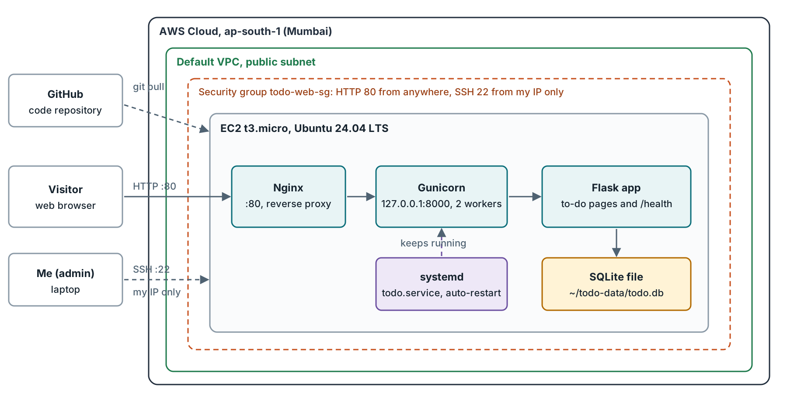
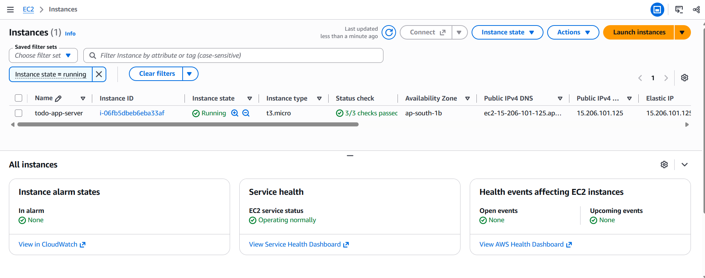
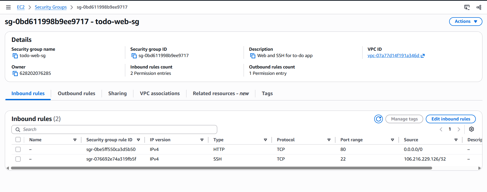
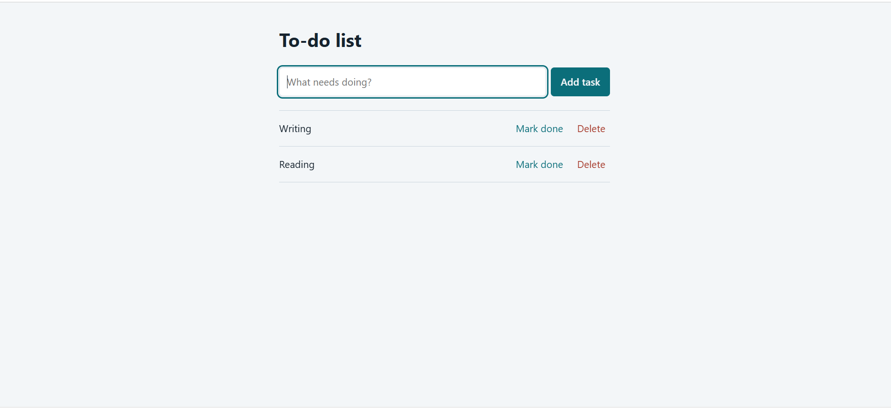
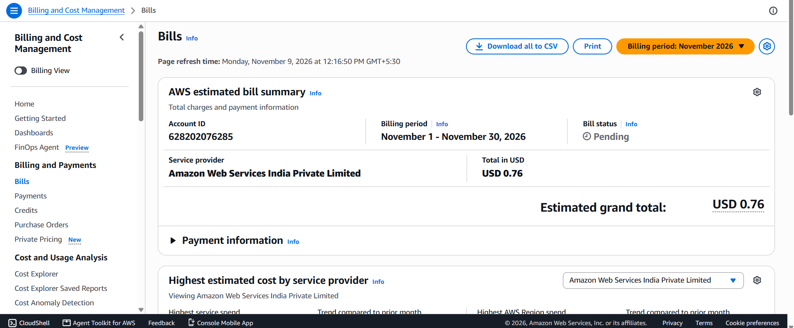

# To-Do App on AWS EC2

A small Flask to-do application deployed on an Ubuntu EC2 instance and run the way a real service is run: Nginx as a reverse proxy, Gunicorn on localhost, and systemd keeping the app alive. Built to practice deployment and operations on AWS, so the app itself is deliberately simple.



## What it does
- Add, complete, and delete tasks from a simple web page
- Stores tasks in a SQLite file
- Exposes a `/health` endpoint for monitoring

## Tech used
| Area | Tools |
|---|---|
| AWS | EC2 (t3.micro, Ubuntu 24.04 LTS), security groups, key pairs, Elastic IP, IAM (admin user with MFA), Budgets |
| Server | Nginx, Gunicorn, systemd |
| App | Python, Flask, SQLite |
| Tools | Git, GitHub |

## How it works
1. A visitor's browser sends a request to the instance on port 80.
2. Nginx receives it and forwards it to Gunicorn on `127.0.0.1:8000`.
3. Gunicorn runs the Flask app, which reads and writes `~/todo-data/todo.db`.
4. systemd starts Gunicorn at boot and restarts it if it crashes.

## Security decisions
- SSH (port 22) is allowed from my IP address only.
- Only HTTP (port 80) is open to the internet.
- Gunicorn listens on localhost, so it cannot be reached directly. Port 8000 is never opened.
- The app runs as an unprivileged user, not root.
- SSH key, `.env` files, and the database are excluded from Git.
- SQL queries are parameterized, and templates escape user input.
- Daily work uses an IAM admin user with MFA. The root user is used only for billing and account settings.

## Deployment
Server config files are stored in [`deploy/`](deploy): [`todo.service`](deploy/todo.service) and [`nginx-todo.conf`](deploy/nginx-todo.conf).

```bash
# On a fresh Ubuntu 24.04 instance
sudo apt update && sudo apt upgrade -y
sudo apt install -y nginx python3-venv python3-pip git

git clone https://github.com/[username]/aws-todo-ec2.git
cd aws-todo-ec2
python3 -m venv .venv
source .venv/bin/activate
pip install -r app/requirements.txt
mkdir -p ~/todo-data

# Run the app as a service
sudo cp deploy/todo.service /etc/systemd/system/todo.service
sudo systemctl daemon-reload
sudo systemctl enable --now todo

# Put Nginx in front of it
sudo cp deploy/nginx-todo.conf /etc/nginx/sites-available/todo
sudo rm -f /etc/nginx/sites-enabled/default
sudo ln -s /etc/nginx/sites-available/todo /etc/nginx/sites-enabled/todo
sudo nginx -t
sudo systemctl reload nginx
```

To deploy an update: `git pull`, then `sudo systemctl restart todo`.

The security group allows SSH (22) from my IP only and HTTP (80) from anywhere.

## Run locally
```bash
python -m venv .venv
source .venv/Scripts/activate      # Git Bash on Windows
python -m pip install -r app/requirements.txt
python app/app.py
```
Then open `http://127.0.0.1:5000`.

## What I tested
| Test | Result |
|---|---|
| App loads through the server's public address | Passed |
| Tasks persist after restarting the service | Passed |
| Reboot the instance | Passed: the app and its data came back with no manual action |
| Kill Gunicorn (`systemctl kill -s KILL todo`) | Passed: systemd restarted it in about 3 seconds (killed at 09:47:29, running again at 09:47:32 UTC) |
| Reach port 8000 from the internet | Passed: the connection timed out after 5 seconds, so the app is only reachable through Nginx |

Versions on the server: Nginx 1.24.0, Python 3.12.3, Git 2.43.0.

## Screenshots
**Instance running**



**Security group rules**



**App running**



**Billing**



## Problems I ran into
| Problem | Cause | Fix |
|---|---|---|
| SSH connection timed out, several times | My public IP changed, so the security group rule was stale | Re-selected My IP on the SSH rule. A better long-term fix is Systems Manager Session Manager, which needs no open SSH port |
| systemd service file was not created | Pasting a multi-line command into the terminal added stray characters, so the closing `EOF` was never seen | Created the file with nano and checked it with `cat` |
| `ModuleNotFoundError: No module named 'flask'` | The virtual environment was not created or not active | Created and activated `.venv`, then installed from `requirements.txt` |
| `git clone` returned "Not Found" | The URL used my display name instead of my GitHub username | Copied the HTTPS URL from the repo's Code button |
| IAM admin user could not open billing pages | Billing access for IAM users must be enabled by the root user | Activated IAM access to billing in Account settings |

## Cost
- Instance: t3.micro in Mumbai, running about [hours] hours.
- Elastic IP and public IPv4 address are charged hourly while allocated.
- Total on the Billing page: [amount]. Billing data can lag by up to a day.
- Resources are stopped or deleted after each session. Budget alerts at $5 and $1 give early warning.

The instance is not kept running, to avoid charges.

## Limitations and next steps
- **HTTP only.** Traffic is not encrypted. Next: HTTPS using CloudFront, or a certificate on Nginx with a domain name.
- **SSH depends on one IP.** Next: Session Manager, so port 22 can be closed.
- **SQLite on a single instance, no backups.** Next: RDS and snapshots.
- **No monitoring or alerts.** Next: CloudWatch alarms.
- **Manual deploys.** Next: an automated pipeline with infrastructure as code.

## Project structure
```
aws-todo-ec2/
├── app/
│   ├── app.py
│   ├── requirements.txt
│   └── templates/index.html
├── deploy/
│   ├── nginx-todo.conf
│   └── todo.service
├── docs/
│   ├── architecture.png
│   ├── billing.png
│   ├── ec2-running.png
│   ├── security-group.png
│   └── todo-app-live.png
├── .gitignore
└── README.md
```
